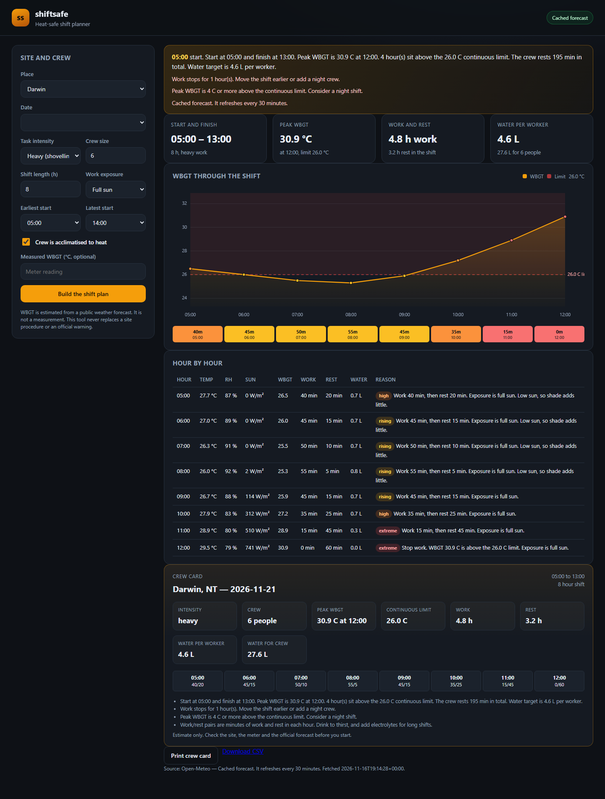
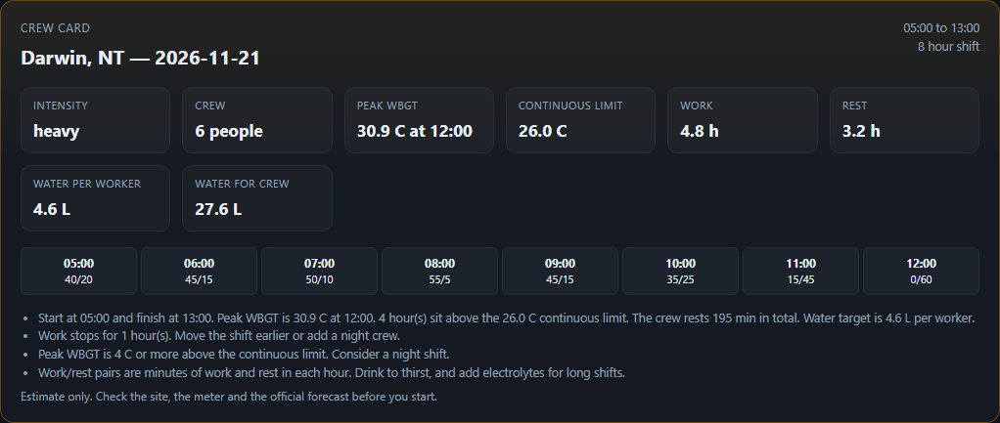

# shiftsafe

Heat-safe shift planner. It estimates WBGT from open weather data. It returns a start
time, work-rest cycles and a water target for the crew.

[](LICENSE)


## Why

A heat rule states a threshold. It does not give a supervisor a plan.
A site manager needs one answer: when should the crew start, when must they rest,
and how much water does each worker need?

shiftsafe turns a public weather forecast into that plan. It scores every legal start
hour against a heat cost. It then prints a crew card that a supervisor can hand out.

Every number is an estimate from weather data. It is not a measurement.

## Features

- **Hourly WBGT for three exposures.** Sun, shade and mixed. The model follows the
  ISO 7243 composition with a bounded solar globe term.
- **Start-time search.** The planner scores each start hour and returns the cheapest
  plan. It prefers a cool morning start over a hot afternoon start.
- **Work-rest allocation.** Minutes of work and rest per hour, from ACGIH allocations
  and ISO 7243 limits. Acclimatised and unacclimatised crews work to different limits.
- **Water target.** Litres per worker and litres for the whole crew, from a sweat-rate
  model that scales with heat.
- **Crew card and CSV.** Print one page for the site. Export the hourly table.
- **Offline fallback.** A bundled real forecast keeps the demo alive when the API is
  unreachable. The banner says which source is in use.

## Quick start

```bash
python -m venv .venv
.venv\Scripts\activate        # Windows
# source .venv/bin/activate   # macOS and Linux
pip install -r requirements-dev.txt
python run.py
```

Open <http://127.0.0.1:8123>.

Pick a place, a date and a task intensity. Press **Build the shift plan**.

Run the tests:

```bash
python -m pytest
```

## Screenshots

Darwin, 21 November 2026, heavy work, 8-hour shift, crew of 6. The planner starts the
crew at 05:00. Peak WBGT is 30.9 °C at 12:00. The crew works 4.8 hours and rests
3.2 hours.



The crew card prints on one page. Work and rest pairs are minutes in each hour.



## How the estimate works

Wet bulb comes from the Stull (2011) fit. It cannot exceed the air temperature.

```
WBGT_shade = 0.7 * Tw + 0.3 * T
uplift     = min(20, 0.03 * shortwave_wm2) / (1 + 0.15 * wind_ms)
WBGT_sun   = 0.7 * Tw + 0.2 * (T + uplift) + 0.1 * T
```

Limits follow ISO 7243:2017 Table 1 for acclimatised workers. An unacclimatised crew
works to limits 2 °C lower. Work-rest points follow ACGIH allocations.

The continuous limits are 30 °C for light work, 28 °C for moderate work and 26 °C for
heavy work. Above the limit, the app cuts work minutes and adds rest.

## Use the API

```bash
curl "http://127.0.0.1:8123/api/plan?place=darwin&intensity=heavy&crew=6&shift_hours=8"
curl "http://127.0.0.1:8123/api/plan.csv?place=darwin&date=2026-11-21" -o plan.csv
```

| Endpoint | Purpose |
|----------|---------|
| `GET /api/health` | Liveness check |
| `GET /api/places?q=` | Search the bundled place table |
| `GET /api/meta` | Intensities, defaults and place count |
| `GET /api/plan` | Full plan document |
| `GET /api/plan.csv` | The hourly table as CSV |

Query parameters for `/api/plan`: `place` or `lat`+`lon`, `date`, `intensity`
(`light`, `moderate`, `heavy`), `crew`, `shift_hours`, `earliest_start`,
`latest_start`, `exposure` (`sun`, `shade`, `mixed`), `acclimatised`,
`measured_wbgt`.

## Data sources

- [Open-Meteo Forecast API](https://open-meteo.com/en/docs) — hourly temperature,
  relative humidity, wind speed and shortwave radiation. Free. No key.
- [ISO 7243:2017](https://www.iso.org/standard/67188.html) — WBGT reference values.
- [ACGIH heat stress TLVs](https://www.acgih.org/) — work-rest allocations.
- [Safe Work Australia](https://www.safeworkaustralia.gov.au/) — heat guidance.
- Bundled snapshot — `data/sample_forecast.json`. A real Open-Meteo response for
  Cherrybrook, NSW, collected on 2026-11-16. It covers three days.

## Limits

- WBGT from weather data is an estimate. Use a meter for a stop decision.
- The model assumes summer workwear and no radiant heat from plant.
- The globe uplift is a bounded assumption, not a published fit.
- The bundled snapshot covers one point and three days.
- This tool never replaces an official warning, a site procedure, or the judgement of
  a supervisor.

## License

MIT. See [LICENSE](LICENSE).